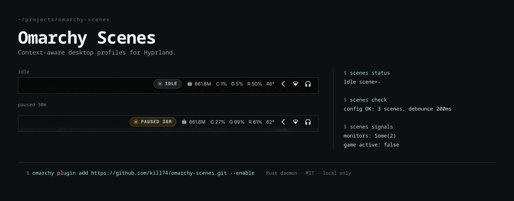

# Omarchy Scenes

Context-aware desktop profiles for Hyprland. Scenes watches Hyprland events and
system signals, applies a named profile when a rule matches, and restores the
previous state when the context ends.



## How it works

Rules read the focused window, workspace, monitor count, Wi-Fi, audio sink,
power and game state. The highest-priority match wins. Each action records a
snapshot, so leaving a scene puts everything back. Everything runs locally —
no network calls, no shell injection.

`scenes status`, `why`, `stats` and `signals` explain what happened. The bar
widget opens a popup with live signals, the last decision and one-click controls.

## Install

The marketplace plugin is just the bar widget. The reactive behaviour lives in a
separate user daemon that must be installed too.

```bash
omarchy plugin add https://github.com/kill74/omarchy-scenes.git --enable
git clone https://github.com/kill74/omarchy-scenes.git
cd omarchy-scenes
./install.sh
```

- **Plugin ID:** `io.github.kill74.scenes` · **Kind:** `bar-widget`
- **Remove plugin:** `omarchy plugin remove io.github.kill74.scenes`
- **Uninstall everything:** `./install.sh --uninstall` (add `--purge-config` to delete config too)

`install.sh` is idempotent: it builds both binaries, installs config only when
none exists, registers the user service and hooks, and places the widget and menu
entries. **No sudo or pkexec is required.**

For testing without touching systemd:

```bash
SCENES_SKIP_BUILD=1 SCENES_BIN_DIR="$PWD/target/debug" SCENES_SKIP_SYSTEMD=1 ./install.sh
```

<details>
<summary><b>Runtime dependencies</b></summary>

Hyprland 0.56+, `hyprctl`, `omarchy`, `bash`, `python3`, `sqlite3`; plus `socat`
(manual-override hook), `pactl` (audio sink), `nmcli` (Wi-Fi SSID), `gamemoded`
(game detection) and `upower` (power/battery). If the daemon is not installed,
the widget stays quiet rather than showing stale state.

</details>

## Quick start

```bash
scenes check              # validate ~/.config/omarchy/scenes/scenes.toml
scenes list               # list scenes
scenes status             # active scene and manager state
scenes apply focus        # apply one manually
scenes off                # leave and restore
scenes pause 30m          # pause auto-switching
scenes resume
scenes signals            # print current extended signals
scenes why                # last decision from the event log
scenes stats              # time spent per scene
scenes suggest            # draft scenes from observed decisions (never applied)
scenes log clear          # delete local decision history
scenes pack inspect examples/focus-pack/scene-pack.toml
scenes panel                # JSON snapshot used by the bar popup
```

Clicking the bar widget opens a panel with live signals, the last decision, and
buttons to apply a scene, pause/resume, leave the active scene, or open the
config. The widget itself shows a live countdown while paused (for example
**PAUSED 30m**).

The Omarchy menu also has a **Scenes** submenu.

## Config

Config lives at `~/.config/omarchy/scenes/scenes.toml`. See
[`config/scenes.toml`](config/scenes.toml) for a complete example. Each
`[[scene.NAME.when]]` block is ANDed within itself; multiple blocks are ORed.
The highest `priority` wins. Every action records a snapshot so it can be
reverted. `debounce_ms` (default 200) smooths Hyprland event bursts;
`signal_poll_ms` (default 1500) controls how quickly external signals such as
Wi-Fi and game state are noticed.

Safety notes:

- Actions run fixed binaries (`omarchy`, `hyprctl`, `pactl`), never a shell.
- `exec` actions are validated by `scenes check` and must declare
  `irreversible = true`.
- A manual theme change pauses auto-switching for `manual_override_pause`.

More detail: [`docs/USAGE.md`](docs/USAGE.md),
[`docs/SCENE_PACKS.md`](docs/SCENE_PACKS.md), [`docs/RECON.md`](docs/RECON.md).

## Releases and packages

- **Releases:** [GitHub releases](https://github.com/kill74/omarchy-scenes/releases) — each tag publishes `scenes` and `scenesd` binaries.
- **Container:** `ghcr.io/kill74/omarchy-scenes:0.1.3` (current) and `:latest`.
- **AUR:** [`packaging/aur/PKGBUILD`](packaging/aur/PKGBUILD) is included; publishing it is a manual maintainer step.

See [`docs/RELEASING.md`](docs/RELEASING.md) for the release checklist.

## Status of roadmap items

- Phases 0–4: complete and verified locally.
- Phase 5: packs, AUR PKGBUILD, CI and docs included.
  - The "suggest via OpenCode API" step is a local draft generator only; no
    external dependency or API call was added.
  - Marketplace-ready: root `manifest.json`, MIT `LICENSE`, `preview.png` and
    install/removal instructions with dependency documentation.
  - No demo GIF is committed.
