# Omarchy Scenes — Roadmap & Agent Brief

> Context-aware desktop profiles for Omarchy. The desktop reacts to *what you are doing*
> (focused app, git repo, game, monitor, power, time) and reconfigures itself — then restores
> everything when the context ends. Explainable, reversible, never surprising.

> **Phase 0 status:** complete on 2026-11-20. Verified facts and exact one-liners are in
> [`docs/RECON.md`](docs/RECON.md); the full command inventory is in
> [`docs/commands.txt`](docs/commands.txt). Corrections found during recon are marked
> **[Phase 0 correction]** below. No feature code has been written.

---

## 1. Product

**One-liner:** Omarchy knows your themes and toggles; Scenes knows *when* you want them.

**Problem:** Omarchy has great switches (theme, toggles, bar, menu) but all manual. Switching
between coding / gaming / meeting / presenting means repeating the same 5–8 actions.

**Differentiators (what makes it new):**
1. **Reactive** — driven by Hyprland IPC events, not by hotkeys.
2. **Reversible** — every scene takes a snapshot; leaving the scene restores it exactly.
3. **Explainable** — `scenes why` tells you which signal triggered which scene.
4. **Learns (opt-in)** — suggests new scenes from your own event log via OpenCode. Never auto-applies.

**Non-goals:** replacing Omarchy menu/bar, modifying `~/.local/share/omarchy/`, cloud anything.
**[Phase 0 correction]** The read-only Omarchy reference is `$OMARCHY_PATH` (`/usr/share/omarchy`
on this machine). `~/.local/share/omarchy/` does not exist here.

---

## 2. Architecture

```
 Hyprland socket2 ──┐
 git/cwd watcher ───┤
 power / udev ──────┼─► Event Normalizer ─► Rule Engine ─► Scene Manager ─► Action Runners
 audio / network ───┤        (Signal)         (match,        (state machine,    ├─ omarchy CLI
 timers ────────────┘                          priority)      snapshot/revert)  ├─ hyprctl keyword
                                                    │                │          ├─ notifications / DND
                                                    ▼                ▼          └─ power / audio
                                              Event Log (SQLite)  Snapshot Store
                                                    │
        CLI `scenes` ◄── Unix socket (JSON-RPC) ────┴──► Bar widget / Omarchy menu extension
```

**Stack:** Rust (daemon + CLI, single binary), `tokio`, `serde`, `toml`, `rusqlite`.
Systemd **user** service. Config in `~/.config/omarchy/scenes/`.
**[Phase 0 correction]** Own runtime state goes in `~/.local/state/omarchy-scenes/`; never
write to `$OMARCHY_PATH` or any Omarchy-owned config. Project docs live in the repo root.

**Hard rules for the agent:**
- NEVER write to `$OMARCHY_PATH` (`/usr/share/omarchy/`) — read-only reference.
- Only touch `~/.config/omarchy/**` and own state in `~/.local/state/omarchy-scenes/`.
- Prefer the `omarchy` CLI over editing config files. Discover commands with `omarchy commands --json`.
  **[Phase 0 correction]** That JSON is an object: `{"ok": ..., "commands": [...]}`.
- Every action must define its own `revert`, or be marked `irreversible = true` (and then warn).

---

## 3. Config schema (TOML)

```toml
# ~/.config/omarchy/scenes/scenes.toml

[settings]
debounce_ms = 400
manual_override_pause = "30m"      # pause auto-switching after a manual change
log_events = true

[scene.focus]
priority = 50
description = "Deep work on code"

  [[scene.focus.when]]             # all keys in one block = AND; blocks = OR
  window_class = ["code", "kitty", "Alacritty"]
  git_repo = "~/dev/*"

  [[scene.focus.do]]
  kind = "omarchy"
  run  = "theme set 'Tokyo Night'"
  # revert is auto-captured via `omarchy theme current`

  [[scene.focus.do]]
  kind = "notify"
  dnd  = true

[scene.gaming]
priority = 80
  [[scene.gaming.when]]
  window_class = ["steam_app_*", "gamescope"]

  [[scene.gaming.do]]
  kind = "hypr"
  keyword = "animations:enabled"
  value = "0"

  [[scene.gaming.do]]
  kind = "omarchy"
  run = "toggle bar"               # [Phase 0 correction] was "toggle waybar"; no waybar here.
                                   # `on` HIDES the bar, `off` shows it — invert on revert.

  [[scene.gaming.do]]
  kind = "power"
  profile = "performance"

[scene.presenting]
priority = 90
  [[scene.presenting.when]]
  monitors_min = 2
  window_class = ["obs", "libreoffice-impress"]
```

**Signals:** `window_class`, `window_title`, `workspace`, `monitors_min`, `monitor_name`,
`git_repo`, `cwd`, `power` (ac/battery), `battery_below`, `time_range`, `ssid`, `audio_sink`.

**Action kinds:** `omarchy`, `hypr`, `notify`, `power`, `audio`, `exec` (opt-in, sandboxed warning).

**Conflict rule:** highest `priority` wins; ties → most recently matched.

---

## 4. Scene lifecycle (state diagram)

```mermaid
stateDiagram-v2
    [*] --> Idle

    Idle --> Evaluating : signal event
    Idle --> Paused : scenes pause
    Evaluating --> Idle : no rule matches
    Evaluating --> Debouncing : rule matches

    Debouncing --> Evaluating : new event inside debounce window
    Debouncing --> Applying : debounce elapsed

    Applying --> Active : all actions ok / snapshot saved
    Applying --> RollingBack : an action failed

    RollingBack --> Idle : snapshot restored / error logged

    Active --> Evaluating : signal event
    Active --> Reverting : exit condition met / scenes off / higher priority scene wins
    Active --> Paused : manual override detected
    Active --> Paused : scenes pause

    Reverting --> Idle : snapshot restored
    Reverting --> Applying : higher priority scene pending

    Paused --> Evaluating : pause expired / scenes resume

    Idle --> [*] : daemon stop
    Active --> Reverting : daemon stop
    Paused --> [*] : daemon stop
```



---

## 5. Roadmap

### Phase 0 — Recon (1–2 days) · *no feature code* — **DONE**
- [x] Read `$OMARCHY_PATH` (bin, config, default, themes) — read-only.
- [x] `omarchy commands --json` → inventory saved to `docs/commands.txt`, findings in `docs/RECON.md`.
- [x] Confirm hook points (`~/.config/omarchy/hooks/`: theme-set, font-set, post-update).
- [x] Confirm menu extension file (`~/.config/omarchy/extensions/omarchy-menu.jsonc`) and its schema.
- [x] Find how bar widgets/panels are defined and how plugins are packaged/installed.
- [x] Confirm Hyprland IPC: `.socket2.sock` events (`activewindowv2`, `workspacev2`, ...).

**Done when:** `docs/RECON.md` lists, per integration point, the exact command/file and a working one-liner. ✅

### Phase 1 — Core daemon (MVP)
- [ ] Cargo workspace: `scenesd` (daemon), `scenes` (CLI), `scenes-core` (lib).
- [ ] Hyprland socket2 listener + event parser (with a **mock socket** for tests).
- [ ] TOML config loader + validation with clear errors (`scenes check`).
- [ ] Rule engine: AND/OR matching, glob support, priority.
- [ ] Scene manager implementing the state diagram in §4.
- [ ] Snapshot/revert for `omarchy` (theme) and `hypr` (keyword) actions.
- [ ] CLI: `scenes list | status | apply <name> | off | pause | resume | check`.
- [ ] systemd user unit + `install.sh` (idempotent, uninstall included).

**Done when:** focusing a configured window switches theme; unfocusing restores the previous one;
`cargo test` passes using only the mock socket; no state leaks after `kill -9` (recovery on next start).

### Phase 2 — Omarchy integration — **DONE**
- [x] Menu extension: "Scenes" entry → list, apply, pause (via `omarchy menu`).
- [x] Bar widget: current scene + paused indicator.
- [x] Notifications on scene enter/leave (configurable, quiet by default).
- [x] Survive `omarchy update` (post-update hook re-validates install and config).
- [x] Manual-override detection (user changes theme/toggle by hand → pause).

### Phase 3 — More signals — **DONE**
- [x] Git repo / cwd of focused terminal (via `/proc` of the window PID).
- [x] Monitor hot-plug, power source, battery threshold, time ranges.
- [x] Game detection (Steam app classes, gamescope, GameMode).
- [x] Audio sink and network SSID.

### Phase 4 — Explain & learn
- [ ] SQLite event log (signals, matches, applied scenes, overrides).
- [ ] `scenes why` — last decision with the exact signals and rule that fired.
- [ ] `scenes suggest` — feeds anonymized log to OpenCode, returns **draft** scenes as TOML.
      Always dry-run first; user approves; nothing auto-applied.
- [ ] `scenes stats` — time per scene.

### Phase 5 — Ecosystem
- [ ] Scene packs (`scenes install <git-url>`), with a permission summary before install.
- [ ] Package for the Omarchy plugin marketplace (format confirmed in Phase 0) + AUR PKGBUILD.
- [ ] Docs, demo GIFs, CI (fmt, clippy, tests), tagged releases.

---

## 6. Brief for OpenCode

**Working agreement**
- Work one phase at a time. Start every phase by restating its checklist and acceptance criteria.
- Small commits, Conventional Commits (`feat:`, `fix:`, `docs:`, `test:`).
- Every new behaviour ships with a test; Hyprland and `omarchy` calls go through traits so they can be mocked.
- No `unwrap()` outside tests. Errors are typed (`thiserror`) and user-facing messages say what to do next.
- If an assumption from this file is wrong (command name, file path), **update `docs/RECON.md` and this file** instead of working around it.
- Ask before: adding a dependency, any `exec` action, anything outside `~/.config/omarchy/` and own state dir.

**First prompt (Phase 0 — completed)**
```
Read ROADMAP.md fully. Execute Phase 0 only: inspect this Omarchy install read-only,
fill docs/RECON.md with verified commands, file paths and Hyprland event names,
and list every assumption in ROADMAP.md that turned out wrong. Do not write feature code.
Stop and summarize when the Phase 0 acceptance criterion is met.
```
